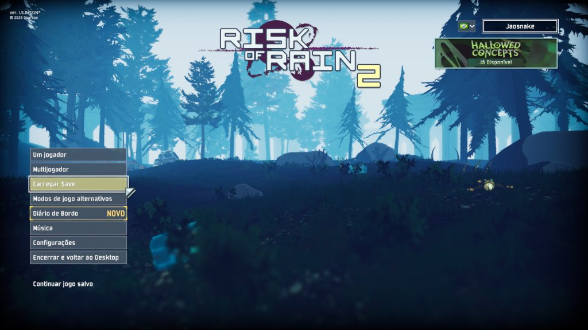
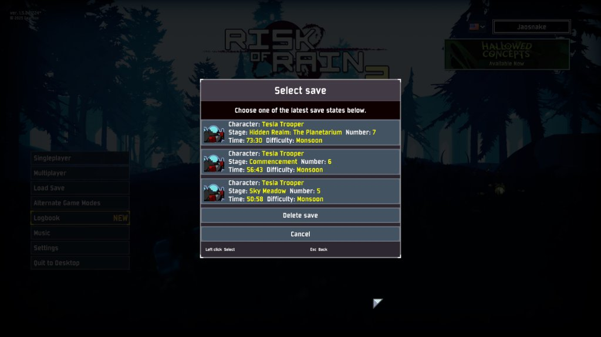

# C.E.N.I - Chrono-Enhanced Nexus of Iteration

**C.E.N.I** is a Risk of Rain 2 save-state mod based on ProperSave, expanded with a save selection UI, controller navigation and Brazilian Portuguese support.

It saves your run at the start of each stage. From the character select lobby, choose **Load** or use the gamepad action bound to it to open the save picker instead of loading blindly.

## Features

- Keeps up to 5 save states per character/lobby group, with smart pruning so multi-scene Hidden Realm events do not overwrite normal stage saves.
- Shows a selectable save list with character, stage name, stage number, run time and difficulty.
- Shows the survivor portrait when available. Caches the displayed name and a small copy separately, and displays the portrait in grayscale with a red X if that character is unavailable.
- Sorts saves by most recent save date first, then stage and run time.
- Keeps save history after death instead of deleting the latest save immediately.
- Supports English for all languages and Brazilian Portuguese when `pt-BR` is selected.
- Supports mouse, keyboard and controller navigation. Use the displayed confirm/back bindings in each dialog.
- Adds a **Load Save** button to the main menu, below Multiplayer, so you can load a save as soon as you enter the game. The Load option in the Singleplayer lobby still works as before.
- Lets you delete individual saves from the lobby interface.
- Supports Classic, Eclipse and Simulacrum save separation through the original ProperSave logic.

## Usage

1. Start or continue a run normally. C.E.N.I saves at the beginning of each stage.
2. Load a save in either of the two ways below.
3. Use the delete option to remove a specific save when desired. Deletion is permanent.

### Load Save from the main menu (new)

A new **Load Save** button now sits right below **Multiplayer** on the main menu, available as soon as you enter the game. It works exactly like the Load option you already know: it opens the same save list (character, stage, number, time and difficulty) with the survivor portraits and the delete option, and picking a save takes you straight into that run, without having to go through the lobby first. The list shows the most recent saves of your profile, from any character. The button stays disabled while your profile has no saves.

### Load from the Singleplayer lobby (as before)

The original way still works normally: in the character select lobby, choose **Load** (or use the gamepad action bound to it) and pick one of the available saves.

Saves are shown with the most recent save at the top, followed by highest stage and run time.

## Languages

- `pt-BR`: Portuguese (Brazil)
- `en`: English fallback for every other language

## Notes

If a saved character is missing, the save remains visible and cannot be loaded until its character mod is restored. The portrait and displayed name are available only if cached while the character was installed; otherwise the internal identifier is shown. Older index-based saves may not identify a changed character reliably. C.E.N.I does not block loading for missing item mods; changing mods may affect restored items and other run content.

Only the host needs the mod for multiplayer loading. Existing ProperSave-style save files use the same save format and storage path. Loading a save after changing the installed mod list can cause incompatibilities.

Do not install this together with the original ProperSave unless you intentionally want to test conflicts. C.E.N.I is intended to replace it in a profile.

## Credits and source

Based on [ProperSave by KingEnderBrine](https://github.com/KingEnderBrine/-RoR2-ProperSave). C.E.N.I is an independent fork with its own package identity and UI/save-management extensions. The upstream repository does not include an explicit license file. This attribution does not grant rights beyond those provided by the respective authors; obtain permission from the upstream author before redistributing the fork if required by their intended licensing terms.

---

# C.E.N.I - Chrono-Enhanced Nexus of Iteration (Português do Brasil)

**C.E.N.I** é um mod de save state para Risk of Rain 2 baseado no ProperSave, expandido com uma tela de seleção de saves, navegação por controle e suporte a português brasileiro.

O mod salva a jogatina no início de cada fase. No lobby de seleção de personagem, escolha **Carregar** ou use a ação correspondente no controle para abrir a seleção de saves, em vez de carregar automaticamente o último save.

## Recursos

- Mantém até 5 save states por personagem/grupo do lobby, com poda inteligente para que subfases de eventos/Reinos Secretos não apaguem os saves das fases normais.
- Exibe uma lista selecionável com personagem, nome da fase, número da fase, tempo de jogo e dificuldade.
- Mostra o retrato do sobrevivente quando disponível. Guarda o nome exibido e uma cópia pequena separadamente e exibe o retrato em preto e branco com um X vermelho se o personagem estiver indisponível.
- Organiza os saves pela data de salvamento mais recente no topo, seguida da fase e tempo de jogo.
- Mantém o histórico de saves depois da morte, em vez de apagar o último save imediatamente.
- Usa português brasileiro quando `pt-BR` está selecionado e inglês como alternativa para os demais idiomas.
- Funciona com mouse, teclado e controle. Os atalhos exibidos em cada diálogo indicam confirmar e voltar.
- Adiciona um botão **Carregar Save** no menu principal, abaixo de Multijogador, para carregar um save assim que você entra no jogo. A opção Carregar no lobby do Um jogador continua funcionando como antes.
- Permite excluir saves individuais pela interface do lobby.
- Mantém a separação de saves de Classic, Eclipse e Simulacrum herdada do ProperSave.

## Como usar

1. Inicie ou continue uma jogatina normalmente. O C.E.N.I salva no começo de cada fase.
2. Carregue um save por qualquer um dos dois caminhos abaixo.
3. Use a opção de excluir para remover um save específico quando necessário. A exclusão é permanente.

### Carregar Save pelo menu principal (novo)

Agora existe um botão **Carregar Save** logo abaixo de **Multijogador** no menu principal, disponível assim que você entra no jogo. Ele funciona exatamente como a opção Carregar que você já conhece: abre a mesma lista de saves (personagem, fase, número, tempo e dificuldade) com os retratos dos sobreviventes e a opção de excluir, e escolher um save leva você direto para aquela jogatina, sem precisar passar antes pelo lobby. A lista mostra os saves mais recentes do seu perfil, de qualquer personagem. O botão fica desabilitado enquanto o seu perfil não tiver nenhum save.

### Carregar pelo lobby do Um jogador (como antes)

O jeito original continua funcionando normalmente: no lobby de seleção de personagem, escolha **Carregar** (ou use a ação correspondente no controle) e selecione um dos saves disponíveis.

Os saves aparecem com o salvamento mais recente no topo, seguido pela fase mais alta e tempo de jogo.

## Idiomas

- `pt-BR`: Português do Brasil
- `en`: alternativa em inglês para todos os outros idiomas

## Observações

Se um personagem salvo estiver ausente, o save continua visível e não pode ser carregado até o mod do personagem ser restaurado. O retrato e o nome exibido só aparecem se tiverem sido guardados enquanto o personagem estava instalado; caso contrário, aparece o identificador interno. Saves antigos baseados em índices podem não identificar com segurança um personagem alterado. O C.E.N.I não bloqueia a partida por mods de itens ausentes; mudanças de mods podem afetar itens e outros conteúdos restaurados.

Somente o anfitrião precisa do mod para carregar uma partida multijogador. Saves no formato do ProperSave usam o mesmo formato e local de armazenamento. Carregar um save após alterar a lista de mods instalada pode causar incompatibilidades.

Não instale este mod junto com o ProperSave original, exceto para testes intencionais de conflito. O C.E.N.I foi feito para substituí-lo no perfil.

## Créditos e código-fonte

Baseado no [ProperSave, de KingEnderBrine](https://github.com/KingEnderBrine/-RoR2-ProperSave). C.E.N.I é um fork independente, com identidade própria de pacote e extensões de interface e gerenciamento de saves. O repositório original não inclui uma licença explícita. Esta atribuição não concede direitos além daqueles fornecidos pelos respectivos autores; obtenha permissão do autor original para redistribuição se exigida pelos termos pretendidos por ele.
